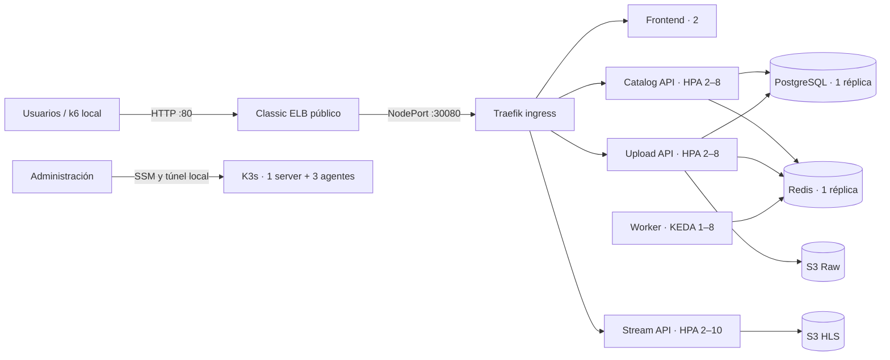

# Informe de arquitectura, capacidad y pruebas de VIBE en AWS

**Fecha de actualización:** 28 de octubre de 2026  
**Entorno:** AWS Academy Sandbox, `us-east-1`, cuenta `911045829576`  
**URL probada:** `http://vibe-desarrollo-elb-643350216.us-east-1.elb.amazonaws.com`  
**Cliente de pruebas:** equipo Windows local, conectado al ELB público; Kubernetes se consultó por el túnel SSM.

## Resumen ejecutivo

VIBE corre en un clúster K3s de cuatro instancias EC2, detrás de un Classic Load Balancer y Traefik. El frontend y las APIs son stateless y tienen HPA; el worker escala con KEDA a partir de la cola Redis. Los audios originales y HLS se guardan en S3. PostgreSQL y Redis tienen una sola réplica y almacenamiento local del clúster.

Las pruebas realizadas confirmaron que el flujo de audio funciona y KEDA procesa cargas, pero también encontraron latencia elevada y timeouts bajo concurrencia. **No podemos afirmar que el sistema soporte una cantidad concreta de usuarios cumpliendo el SLO actual.** Con 1 y 10 VUs k6 no observó errores HTTP, pero el p95 superó el objetivo de 500 ms; con 24 solicitudes concurrentes a catálogo, 11,1% agotó el timeout del cliente. El HPA de catálogo no aumentó sus dos réplicas durante ese ensayo.

La capacidad física configurada es 8 vCPU y 10 GiB de RAM nominales en las cuatro EC2. Esto no equivale a capacidad de usuarios. En la prueba de KEDA, 12 audios sintéticos se completaron en 302 s, KEDA alcanzó 5 workers y una lectura puntual mostró un agente al 95% de CPU. Ese resultado indica un límite de cómputo relevante para transcodificación, no una capacidad sostenible para usuarios.

## Arquitectura desplegada



### Capa AWS

| Componente | Configuración observada |
|---|---|
| Región y red | `us-east-1`; VPC predeterminada y subredes públicas en distintas zonas |
| EC2 | 1 `t3.medium` para K3s server y 3 `t3.small` para agentes; cuatro instancias activas |
| Discos raíz | EBS cifrado: 20 GiB en server y 15 GiB por agente; 65 GiB configurados en total |
| Balanceador | Classic ELB público, HTTP 80 hacia NodePort 30080; health check `/healthz` |
| Objetos | Buckets S3 separados para audio original (`raw`) y transcodificado (`hls`) |
| Estado y administración | State de Terraform en S3; token K3s en SSM Parameter Store como `SecureString`; perfil IAM de instancia |
| Acceso de administración | Kubernetes se consultó mediante un túnel SSM local; el API no se expone directamente a Internet |

El balanceador expone **HTTP sin TLS**, aceptable solo para esta demo académica. PostgreSQL y Redis son puntos únicos de falla. Sus PVC `local-path` son de 2 GiB y 1 GiB respectivamente; no son almacenamiento replicado entre zonas. El plano de control K3s también tiene un solo server.

### Capa Kubernetes

| Workload | Réplicas observadas | Límite en desarrollo | Requests CPU / memoria por pod |
|---|---:|---:|---:|
| Frontend | 2 | 2 | 50m / 32 MiB |
| Catalog API | 2 | 8 | 100m / 128 MiB |
| Upload API | 2 | 8 | 150m / 160 MiB |
| Stream API | 2 | 10 | 150m / 128 MiB |
| Worker | 1 | 8 por KEDA | 100m / 96 MiB |
| PostgreSQL | 1 | 1 | 200m / 256 MiB; límite 1 CPU / 512 MiB |
| Redis | 1 | 1 | 50m / 64 MiB; límite 500m / 256 MiB |

Con los autoscalers al máximo, el diseño suma hasta 38 pods de aplicación/datos y requests aproximados de 4,65 CPU y 4.736 MiB. No incluye K3s, Traefik ni otros componentes del sistema. Es una suma teórica de solicitudes a Kubernetes; no demuestra que esa cantidad de pods quepa o funcione a plena carga en las cuatro máquinas.

Presupuesto teórico de conexiones a PostgreSQL al máximo configurado: Catalog 32, Upload 24 y Worker 8, un total de **64 conexiones de aplicación** antes de clientes administrativos. Se debe validar contra `max_connections` y los recursos reales de PostgreSQL, que tiene límite de 1 CPU y 512 MiB.

## Cuotas y costos consultados

El 28/10/2026, Service Quotas indicó 256 vCPU estándar EC2; las cuatro T3 activas suman 8 vCPU nominales. AWS Academy indicó un límite práctico de 9 instancias y este despliegue utiliza 4.

Cost Explorer mostró unos USD 0,319 acumulados del 1 al 29 de octubre para toda la cuenta: VPC USD 0,203, EC2 Compute USD 0,106 y CloudWatch USD 0,010. No estaba filtrado por proyecto ni etiquetas; no representa un costo aislado de VIBE. La consulta a CloudFormation no encontró stacks antiguos de VIBE; los stacks enumerados pertenecían al Lab IDE de AWS Academy y se dejaron intactos.

## Capacidad: qué sabemos y qué no

- **Capacidad nominal instalada:** 8 vCPU y 10 GiB de RAM en EC2 antes de reservar recursos para Linux, K3s, Traefik y servicios del sistema.
- **Capacidad de transcodificación observada:** 12 subidas sintéticas procesadas; KEDA alcanzó 5 workers, cola máxima de 9 trabajos y finalización total en 302,3 s. Una muestra durante el procesamiento mostró CPU de 44%, 95%, 55% y 57% en los cuatro nodos, y memoria entre 39% y 47%.
- **Carga de escucha observada:** 10 VUs durante 2 minutos, 1.591 solicitudes HTTP y cero respuestas fallidas según k6; throughput 11,70 solicitudes/s. El p95 global fue 1.460 ms y el p95 de segmentos HLS 2.130 ms.
- **Límite observado en la prueba de HPA:** a 24 solicitudes concurrentes a catálogo, el cliente reportó 11,075% de timeouts/errores y p95 9.024,5 ms. El HPA mantuvo 2 réplicas. Los errores se registraron como estado `0` (timeout o fallo de conexión del cliente), no como respuestas HTTP 4xx/5xx.

Los perfiles de k6 representan sesiones sintéticas: cada iteración consulta catálogo, manifiesto HLS, variante y hasta tres segmentos, y luego duerme entre 0,5 y 2,5 s. Los ensayos salieron desde Windows a través de Internet y el ELB público. Por eso mezclan latencia del cliente/red pública con la aplicación y S3; no equivalen a una prueba desde la misma región o VPC.

**Conclusión de capacidad:** no se debe presentar “soporta N usuarios” como cifra validada. El máximo probado sin errores HTTP fue 10 VUs, pero incumplió los objetivos de latencia; a 24 solicitudes concurrentes hubo timeouts. El SLO inicial de k6 es errores <1%, p95 global <500 ms y p95 de segmento HLS <400 ms. Incluso el ensayo de 1 VU ya superó ambos objetivos de latencia. Se necesita diagnosticar la latencia y repetir desde un generador dentro de `us-east-1` antes de fijar una capacidad sostenible.

Los resultados históricos `results/k6/load-20260930-001005-497261.json` y `stress-20260930-003726-131735.json` tienen 0 solicitudes y no sirven para estimar capacidad.

## Latencia medida el 28/10/2026

Las cifras de k6 son desde Windows hacia el ELB público. `p95 global` incluye consultas de catálogo y recursos HLS; `p95 segmento` mide segmentos individualmente.

| Ensayo | VUs | Solicitudes | Errores | RPS | p95 global | p95 segmento | Objetivos |
|---|---:|---:|---:|---:|---:|---:|---|
| k6 oyentes, 1 minuto | 1 | 121 | 0% | 1,97 | 580,9 ms | 688,4 ms | Falló latencia |
| k6 oyentes, 2 minutos | 10 | 1.591 | 0% | 11,70 | 1.460 ms | 2.130 ms | Falló latencia |
| HPA catálogo, escalones 4/12/24 | hasta 24 | 2.131 | 11,075% | — | 9.024,5 ms | — | Falló; HPA no escaló |
| API durante fallo de pod | — | 3 sondeos | 66,7% | — | 9.184,7 ms | — | 2 sondeos excedieron timeout de 3 s |
| PostgreSQL apagado/restaurado | — | véase evidencia previa | — | — | — | — | Volvió a Ready en 12,076 s |

En la prueba de pod se borró un pod de `catalog-api`: el reemplazo quedó disponible en 8,957 s. El sondeo al endpoint tuvo 2 errores de 3 porque el cliente de la prueba tiene timeout de 3 s. La aplicación volvió a responder después de la sustitución.

La prueba previa de PostgreSQL restauró su única réplica y recuperó la API en 12,076 s. Durante esa interrupción, `/api/tracks` tuvo 22 errores en 29 solicitudes; streaming HLS siguió respondiendo. La recuperación no significa alta disponibilidad: la API de catálogo depende de esa única base.

## Pruebas ejecutadas y resultado

| Prueba | Resultado observado | Estado posterior |
|---|---|---|
| Smoke HTTP `/`, `/api/stats`, `/api/tracks` | HTTP 200 antes y después de los ensayos | Correcto |
| Reinicios graduales de Catalog, Upload y Stream API | Rollouts completados con las réplicas listas | Correcto |
| k6 oyentes, 1 VU / 1 min | 121 solicitudes, sin errores; p95 580,9 ms | Funcional, latencia fuera de objetivo |
| k6 oyentes, 10 VUs / 2 min | 1.591 solicitudes, sin errores; p95 1.460 ms | Funcional, latencia fuera de objetivo |
| HPA Catalog, concurrencia 4/12/24 | 2.131 solicitudes; 236 timeouts/errores; p95 9.024,5 ms; no pasó de 2 réplicas | Degradación observada; se detuvo la carga |
| Fallo de un pod Catalog API | Reemplazo listo en 8,957 s; 2/3 sondeos agotaron timeout de 3 s | Recuperado |
| Worker/KEDA, 12 audios sintéticos | 12/12 listos, cola pico 9, máximo 5 workers, 302,3 s; p95 de subida 32,6 s | Tracks de prueba borrados y cola vacía |
| Caída de PostgreSQL | Recuperación previa a Ready/API en 12,076 s; errores esperados durante caída | Recuperado |
| OOM del worker | No ejecutado: la revisión automática bloqueó el comando de agotamiento deliberado de memoria | Worker no se modificó; conserva request 96 MiB y límite 512 MiB |
| Caída de una EC2/nodo | No ejecutada: AWS CLI local no tenía credenciales para detener/restaurar EC2 | No se interrumpió ningún nodo |
| Rolling update de imagen | No ejecutado en AWS: el script disponible usa Kind/Docker y la versión AWS tiene una ruta de distribución con bucket antiguo codificado | No se cambió imagen |
| Estrés/spike/ramp de alta concurrencia | No ejecutados: los perfiles pequeños ya incumplieron latencia y 24 solicitudes concurrentes produjo timeouts | Se detuvo el aumento de carga |

### Estado final verificado

Después de las pruebas: 4/4 nodos K3s `Ready`; frontend 2/2, Catalog 2/2, Upload 2/2, Stream 2/2, Worker 1/1, Redis 1/1 y PostgreSQL 1/1. Los HPA volvieron a su mínimo de 2 réplicas para las APIs; KEDA quedó en 1 worker con cola Redis en cero. `/`, `/api/stats` y `/api/tracks?status=ready&limit=1` devolvieron HTTP 200.

## Evidencias

- Resumen k6 1 VU: `vibe/results/k6/aws-users-1vu-20261028.json`.
- Resumen k6 10 VUs: `vibe/results/k6/aws-users-10vu-20261028.json`.
- Prueba HPA: `C:\Users\Michael\vibe-evidence\20261028T073442Z-hpa` (summary, CSV de carga y serie de escalado).
- Fallo de pod: `C:\Users\Michael\vibe-evidence\20261028T073933Z-pod`.
- Worker/KEDA: `C:\Users\Michael\vibe-evidence\20261028T074031Z-keda` (summary, subidas y serie de cola/workers).
- Caída de PostgreSQL anterior: `C:\Users\Michael\vibe-evidence\20261028T070734Z-db`.
- Los JSON de k6 incluyen el resultado de `setup`, con IDs de pistas consultadas; no contiene credenciales. Los CSV/JSON de ensayos se guardaron localmente fuera del repositorio en `vibe-evidence`.

## ¿Se pueden ejecutar pruebas AWS desde `k8s-web`?

Sí, con el túnel SSM abierto y `KUBECONFIG` apuntando a `%USERPROFILE%\.kube\config-vibe-aws.yaml`. Antes de iniciar k8s-web, `API` y `BASE_URL` deben apuntar al ELB. Las peticiones de k6 y las subidas salen desde Windows; el túnel solo se usa para consultas/modificaciones del API Kubernetes.

```powershell
$env:KUBECONFIG = Join-Path $env:USERPROFILE '.kube\config-vibe-aws.yaml'
$env:API = 'http://vibe-desarrollo-elb-643350216.us-east-1.elb.amazonaws.com'
$env:BASE_URL = $env:API
Set-Location 'C:\Users\Michael\Universidad\Cloud Computing\vibe_k8s\k8s-web'
& 'C:\Users\Michael\AppData\Local\Python\bin\python.exe' server.py --ns vibe
```

No usar contra AWS los botones de caída de nodo o rolling update de k8s-web: esos escenarios operan sobre contenedores/imagenes Kind. La ruta OOM cambia recursos/comando del worker y requiere restauración verificada; no debe ejecutarse sin una ventana controlada. Antes de más carga, usar un generador en `us-east-1`, registrar recursos y revisar las latencias por ruta.

## Mejoras para pruebas más realistas

1. Ejecutar k6 desde una máquina generadora en la misma región (idealmente VPC) y conservar aparte una prueba externa de experiencia de usuario.
2. Modelar sesiones de escucha que respeten `#EXTINF`, tiempo de reproducción y cambio de canciones; alternar catálogo, búsquedas, streams y pausas.
3. Medir por ruta p50/p95/p99, errores, RPS, CPU/memoria de nodos y pods, CPU credits T3, HPA/KEDA, conexiones/espera de PostgreSQL, profundidad/edad de Redis y objetivos del ELB.
4. Corregir/explicar los timeouts de catálogo y el hecho de que el HPA no escaló antes de ejecutar stress/spike. Revisar métricas de CPU, requests, concurrencia de DB y códigos/tiempos desde el mismo generador.
5. Mantener pruebas en etapas: baseline, 1, 5, 10 y más usuarios solo si se cumplen objetivos; repetir niveles y sostenerlos para permitir que HPA/KEDA reaccionen.
6. Crear IDs únicos, verificar eliminación de tracks y objetos S3, y confirmar Redis en cero tras las pruebas de worker.
7. Añadir en k8s-web perfiles explícitos `Kind/AWS`, guardas de cuenta/contexto/ELB y distinguir scripts locales de acciones AWS.

## Fuentes del repositorio

- Terraform: `vibe/terraform/envs/desarrollo/`, `vibe/terraform/modules/k3s-cluster/`, `vibe/terraform/modules/network/`.
- Kubernetes: `vibe/k8s/base/`, `vibe/k8s/overlays/desarrollo/`.
- Ensayos AWS: `vibe/aws/demo.py`, `vibe/aws/DEMONSTRATIONS.md`.
- k6: `vibe/tests/k6/`, `vibe/tools/run_k6.py`.
- Panel: `k8s-web/README.md`, `k8s-web/server.py`.
